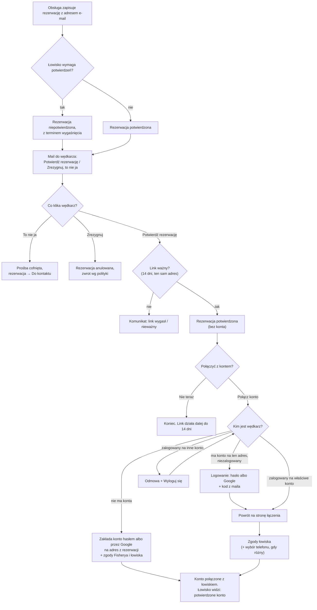
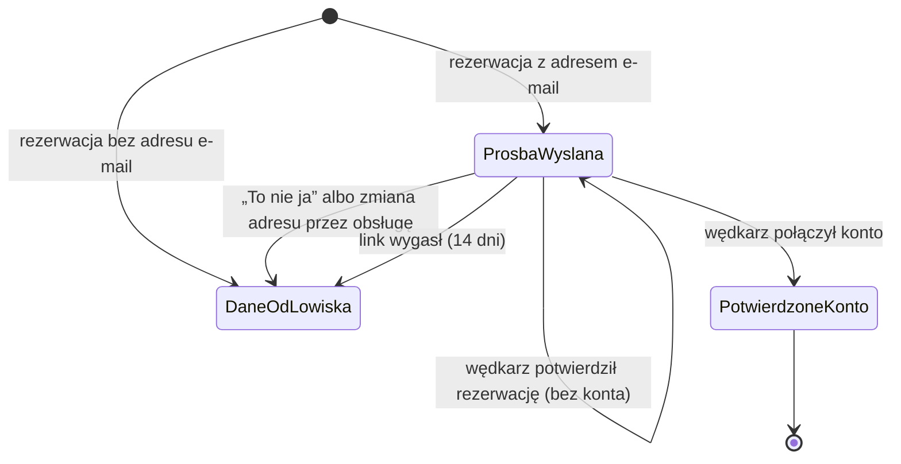

# Potwierdzenie rezerwacji i połączenie z kontem

## W skrócie

Gdy obsługa łowiska zapisze rezerwację z adresem e-mail wędkarza, wędkarz dostaje mail z dwoma przyciskami:
**„Potwierdź rezerwację"** i **„Zrezygnuj / to nie ja"**.

- **Potwierdzenie nie wymaga konta.** Jedno kliknięcie wystarcza — kliknięcie dowodzi, że wędkarz ma dostęp do
  skrzynki, a tego potrzebuje łowisko.
- **Połączenie z kontem jest dobrowolne** i następuje dopiero po potwierdzeniu. Daje wędkarzowi historię
  rezerwacji w jednym miejscu, a łowisku — aktualne dane z konta wędkarza.
  - Wędkarz **ma już konto** na ten adres → musi się na nie **zalogować** (hasło albo Google, potem kod z maila).
  - Wędkarz **nie ma konta** → zakłada je (hasłem albo przez Google) **na adres z rezerwacji**.
  - Przy zakładaniu konta akceptuje dokumenty Fisherya i łowiska, przy łączeniu istniejącego konta — tylko
    dokumenty łowiska.
  - Wędkarz zalogowany na **inne konto** dostaje odmowę i propozycję wylogowania.
  - **„Nie teraz"** — rezerwacja zostaje potwierdzona, a link z maila pozwala połączyć konto przez 14 dni.
- **Łowisko** zawsze widzi ten sam komunikat „wysłano prośbę o potwierdzenie" — nie dowiaduje się, czy adres ma
  konto w portalu. W panelu widzi osobno **status rezerwacji** (np. potwierdzona) i **dane wędkarza**
  („wpisane ręcznie" albo „potwierdzone konto").
- **„To nie ja"** cofa prośbę, rezerwacja trafia do „Do kontaktu" (nie jest anulowana). **„Zrezygnuj"** anuluje
  rezerwację ze zwrotem według polityki zwrotu.

Dlaczego tak: link z maila mógł trafić w niepowołane ręce (przekazany mail, podgląd w skrzynce). Dlatego link
potwierdza rezerwację, ale **nie daje dostępu do konta** — do tego trzeba się zalogować.

## Przebieg

## Stan wędkarza w łowisku

W panelu „Prośba wysłana" i „Wpisane ręcznie" wyglądają tak samo — **„Wpisane ręcznie"**. Dopiero połączenie
konta zmienia to na **„Potwierdzone konto"**.

## Dla zespołu

| Krok | Gdzie | Decyzja |
|---|---|---|
| Wysyłka prośby, limity | `ReservationConfirmation::afterBooking()` → `AnglerLinking::requestConfirmation()` | ADR-024 pkt 8 |
| Potwierdzenie bez konta | `ReservationLinkController::confirmSubmit()` → `AnglerLinking::confirmReservations()` | ADR-024 akt. 2026-10-11 |
| Znacznik łączenia i powrót po logowaniu | `AnglerLinkSession`, `PanelHome::redirectAfterSignIn()`, `TwoFactorController` | zadanie 049, R2 |
| Strona łączenia (tryby) | `ReservationLinkController::account()` / `accountSubmit()` | zadanie 049 |
| Połączenie / konto z linku | `AnglerLinking::link()` / `registerAndLink()` | ADR-024 akt., ADR-028 |
| Zgody | `ConsentRegistry` | ADR-028 |
| Rezygnacja, „to nie ja" | `AnglerLinking::resign()` / `notMe()` | zadanie 043, 047 |

Konwencje: [`rezerwacje.md`](../conventions/rezerwacje.md) §3, [`strona-publiczna.md`](../conventions/strona-publiczna.md) §8,
[`autoryzacja.md`](../conventions/autoryzacja.md) §6. Testy: `AnglerLinkingTest`, `AccountLinkingConsentsTest`.
