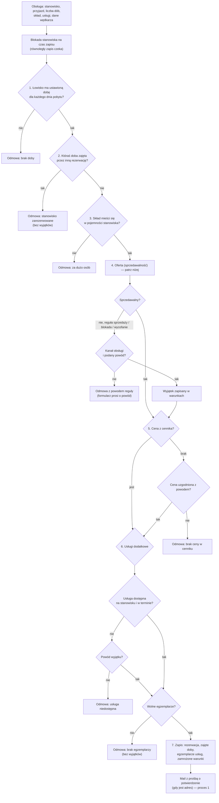
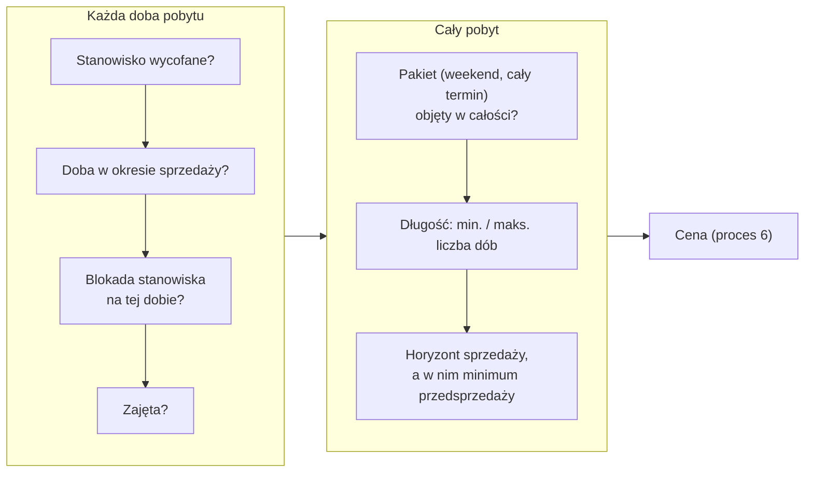

# Tworzenie rezerwacji i kolejność reguł

## W skrócie

Rezerwację zakłada obsługa łowiska — z kalendarza albo pełnym formularzem. Zanim system ją zapisze, sprawdza
termin w **stałej kolejności**. Kolejność ma znaczenie: odmowa podaje **pierwszy** napotkany powód, więc
najpierw sprawdzane są przyczyny najtrwalsze (te, których nie da się „przeczekać").

Trzy rodzaje odpowiedzi:

- **Twarda odmowa — nie da się obejść nigdy:** stanowisko już zajęte w tym terminie, za dużo osób na stanowisku,
  łowisko bez ustawionej doby, brak wolnych egzemplarzy usługi (np. wszystkie łódki wypożyczone).
- **Odmowa, którą obsługa może świadomie przekroczyć z powodem:** termin poza sezonem, blokada stanowiska,
  stanowisko wycofane, za krótki albo za długi pobyt, przerwany pakiet weekendowy, termin za daleko w przyszłości,
  usługa nieoferowana na tym stanowisku. Powód zapisuje się z nazwiskiem i godziną.
- **Brak ceny** — termin bez stawki w cenniku: obsługa może wpisać **cenę uzgodnioną** (też z powodem).

Wędkarz kupujący sam w portalu (etap 4) nie ma żadnych wyjątków — dostaje odmowę.

Po zapisie rezerwacja ma **zamrożone warunki**: cenę z rozbiciem, politykę zwrotu, wersje dokumentów i dane
kontaktowe z tej chwili. Późniejsza zmiana cennika czy regulaminu jej nie zmienia.

Dwie rezerwacje tego samego stanowiska na ten sam termin są niemożliwe — także wtedy, gdy dwie osoby klikną
„Zapisz" w tej samej sekundzie (system zakłada blokadę na stanowisko na czas zapisu).

## Kolejność sprawdzania

### Krok 4 — co znaczy „sprzedawalny"

Warstwa oferty sprawdza najpierw **każdą dobę osobno**, potem **cały pobyt**:

Zawieszenie cechy stanowiska (np. „prąd chwilowo nie działa") **nie blokuje** sprzedaży — jest tylko
informacją.

## Dla zespołu

| Krok | Gdzie | Decyzja |
|---|---|---|
| Jedyna ścieżka zapisu, blokady, kolejność 1–7 | `ReservationBooking::write()` | ADR-025 pkt 4, ADR-026 |
| Zajętość sprawdzana wprost, przed ofertą | `PositionAvailability::isOccupied()` | ADR-025 |
| Sprzedawalność doby i pobytu | `PositionAvailability`, `StaySellability` (przez `StayOffer`) | ADR-012, ADR-013, ADR-015 |
| Wyjątki operatora | `ReservationTermsSnapshot::exception()`, `ReservationSource::allowsExceptions()` | ADR-026 pkt 8, ADR-027 pkt 7 |
| Usługi i limit egzemplarzy | `StayOffer::services()`, `ServiceStock::remaining()` | zadanie 020, 047 |
| Formularze | `ReservationFormSchema`, `ReservationFormSubmission` | zadanie 041, 047 |

Konwencje: [`dostepnosc.md`](../conventions/dostepnosc.md) §2–§6, [`rezerwacje.md`](../conventions/rezerwacje.md) §1.
