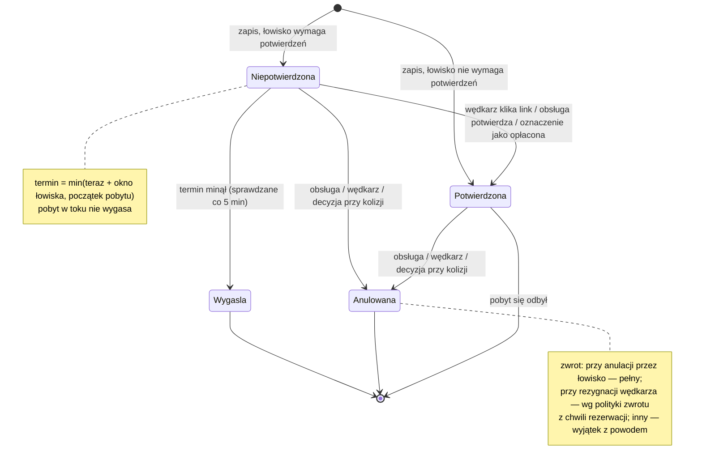
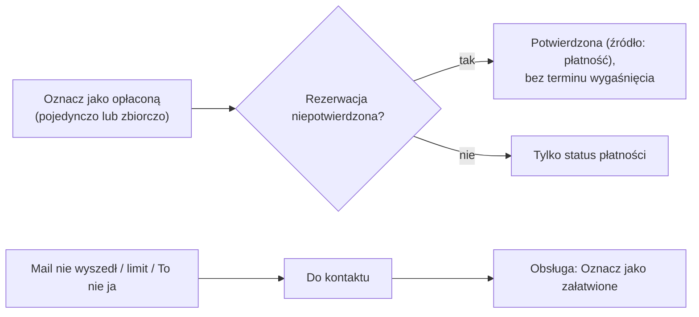

# Cykl życia rezerwacji

## W skrócie

Rezerwacja ma jeden z czterech statusów:

- **Niepotwierdzona** — gdy łowisko wymaga potwierdzeń. Czeka na wędkarza (link w mailu) albo obsługę. Ma
  **termin wygaśnięcia**: okno ustawione przez łowisko (domyślnie 48 h), ale **najpóźniej początek pobytu**.
- **Potwierdzona** — potwierdził ją wędkarz, obsługa albo płatność. **Opłacona rezerwacja jest zawsze
  potwierdzona.** Gdy łowisko nie wymaga potwierdzeń, rezerwacja od razu jest potwierdzona.
- **Wygasła** — nikt jej nie potwierdził w terminie. Stanowisko się zwalnia, wędkarz z adresem dostaje mail.
- **Anulowana** — przez obsługę, przez wędkarza („Zrezygnuj") albo decyzją przy zmianie konfiguracji (proces 4).
  Stanowisko się zwalnia, rezerwacja zostaje w historii.

Niezależnie od statusu rezerwacja może trafić do **„Do kontaktu"** — gdy system nie mógł się skontaktować
z wędkarzem za łowisko (brak adresu przy ważnej sprawie, błąd wysyłki, limit maili, „To nie ja"). Obsługa
dzwoni i klika „Oznacz jako załatwione".

Pobyt, który już się zaczął, **nie wygasa**. Anulacja trwającego pobytu wymaga dodatkowego potwierdzenia.
Zmiana terminu, stanowiska, składu, usług albo ceny to **jawna zmiana warunków** z powodem — historia zostaje
w dzienniku.

## Statusy

## Płatność i „Do kontaktu"

## Dla zespołu

| Zdarzenie | Gdzie | Decyzja |
|---|---|---|
| Termin wygaśnięcia | `ReservationConfirmation::deadlineFor()` | ADR-024 pkt 7, akt. 2026-10-11 |
| Wygaszanie | `reservations:expire` → `ReservationBooking::expire()` (co 5 min) | zadanie 045 |
| Potwierdzenie | `ReservationBooking::confirm()` (`ConfirmationSource`) | ADR-024 |
| Płatność potwierdza | `ReservationBooking::setPaymentStatus()` | ADR-024 akt. (047) |
| Anulacja i zwrot | `ReservationBooking::cancel()` | ADR-026, ADR-027 pkt 5 |
| Zmiana warunków | `ReservationBooking::rebook()` / `updateContact()` | ADR-026 pkt 3, zadanie 047 C2 |
| Do kontaktu | `markNeedsContact()` / `markContacted()` | zadanie 043 |

Konwencje: [`rezerwacje.md`](../conventions/rezerwacje.md) §1, §5; historia w kanale `reservations`
([`dziennik-zmian.md`](../conventions/dziennik-zmian.md) §6).
