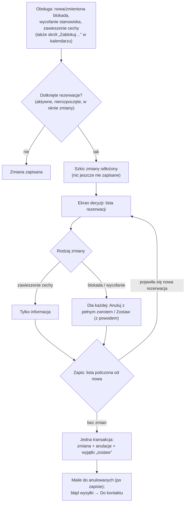

# Kolizje zmian konfiguracji z rezerwacjami

## W skrócie

Gdy obsługa zmienia coś, co dotyka już sprzedanych terminów — **zakłada blokadę** stanowiska, **wycofuje
stanowisko** ze sprzedaży albo **zawiesza cechę** stanowiska — system najpierw sprawdza, czy są rezerwacje,
których to dotyczy. Liczą się rezerwacje **aktywne i jeszcze nierozpoczęte**; pobyt w toku nigdy nie trafia na
listę.

- **Brak kolizji** → zmiana zapisuje się od razu.
- **Kolizja** → zmiana **jeszcze się nie zapisuje**. Obsługa trafia na ekran decyzji i dla każdej rezerwacji
  wybiera:
  - **„Anuluj z pełnym zwrotem"** — wędkarz dostaje mail (z komunikatem wspólnym albo indywidualnym);
  - **„Zostaw"** — rezerwacja zostaje mimo blokady, z zapisanym powodem; widać ją w kalendarzu na zablokowanej
    dobie.
  - Przy zawieszeniu cechy jest tylko informacja — sprzedaż i rezerwacje się nie zmieniają.
- Zmiana i decyzje zapisują się **razem**. Jeśli w międzyczasie ktoś zarezerwował kolejny termin, którego
  zmiana dotyczy, system wraca do decyzji zamiast zapisać po cichu.
- Stanowiska z przyszłymi rezerwacjami **nie da się usunąć** — trzeba je najpierw wycofać (ekran decyzji) albo
  anulować rezerwacje.

## Przebieg

## Dla zespołu

| Krok | Gdzie | Decyzja |
|---|---|---|
| Wykrycie kolizji | `CollisionGate` → `ConfigurationCollisionService::affected()` | ADR-027 |
| Szkic zmiany w sesji | `CollisionDrafts`, `ConfigurationChange` | ADR-027 pkt 1 |
| Ekran decyzji | `FisheryResource\Pages\ResolveCollisions` | zadanie 044 |
| Zapis zmiany i decyzji | `ConfigurationCollisionService::apply()` (`StaleCollisionDecision`) | ADR-027 |
| „Zostaw" | `ReservationBooking::recordException()` (`block_id`) | ADR-027 pkt 3, 7 |
| Usuwanie stanowiska | `CollisionGate::blockingDeletion()` | zadanie 044 |

Konwencje: [`rezerwacje.md`](../conventions/rezerwacje.md) §4, [`dostepnosc.md`](../conventions/dostepnosc.md) §3.
