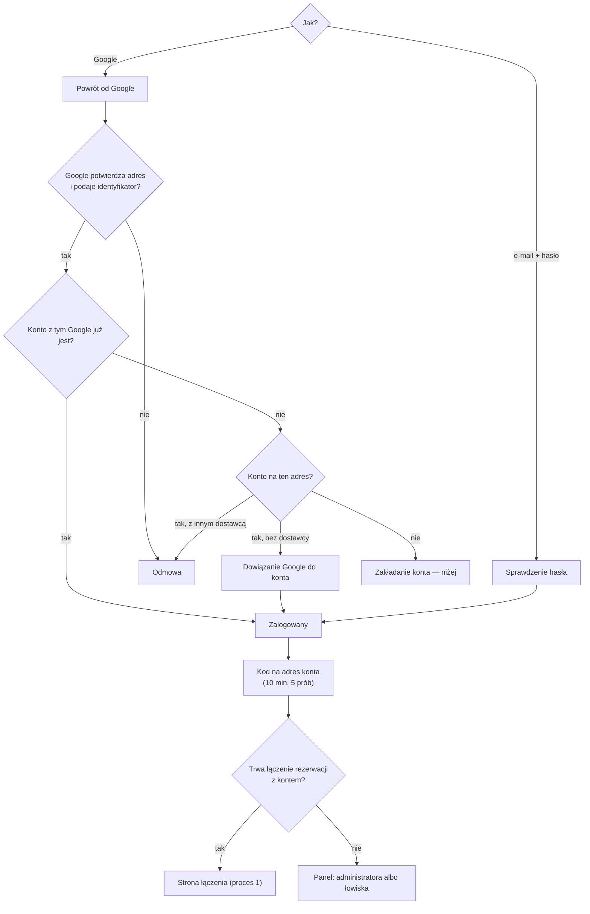
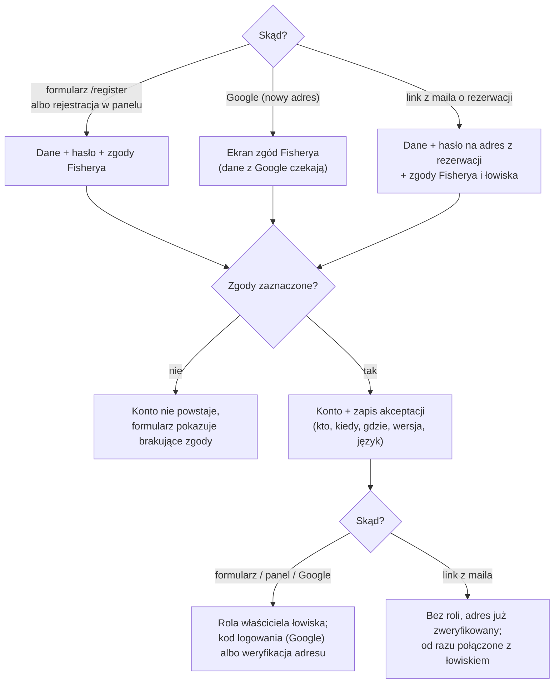

# Logowanie i zakładanie konta

## W skrócie

**Logowanie.** Do konta wchodzi się adresem e-mail i hasłem albo przez Google. Po **każdym** logowaniu na adres
konta przychodzi sześciocyfrowy kod (ważny 10 minut, pięć prób). Dopiero po jego wpisaniu użytkownik trafia do
panelu — administrator do panelu administratora, pozostali do panelu łowiska. Wyjątek: jeśli wędkarz właśnie
łączy rezerwację z kontem (proces 1), po logowaniu wraca na stronę łączenia.

**Google a istniejące konto.** Jeśli ktoś ma konto założone hasłem i zaloguje się przez Google na ten sam adres,
system łączy oba sposoby logowania — ale tylko gdy Google **potwierdza** adres. Hasło dalej działa. Jedno konto
może mieć jednego dostawcę logowania.

**Zakładanie konta.** Konto zakłada wyłącznie sam użytkownik — formularzem, w panelu, przez Google albo
z linku w mailu o rezerwacji. Za każdym razem musi **zaakceptować regulamin i zapoznać się z polityką
prywatności Fisherya** (gdy Fisherya ma obowiązującą wersję). Przy Google zgody zaznacza się na osobnym ekranie
po powrocie od Google — konto powstaje dopiero potem. System zapisuje, kto, kiedy, gdzie i którą wersję
(w którym języku) zaakceptował.

## Logowanie

## Zakładanie konta

## Dla zespołu

| Krok | Gdzie | Decyzja |
|---|---|---|
| Kod 2FA, licznik prób | `TwoFactorController`, `TwoFactorMiddleware` | `autoryzacja.md` §6 |
| Google i dowiązanie po adresie | `SocialAuthController` | ADR-019 |
| Dokąd po logowaniu | `PanelHome::urlFor()` / `redirectAfterSignIn()` | zadanie 031, 049 R2 |
| Zgody przy rejestracji | `RegisteredUserController`, `Filament\Pages\Auth\Register`, `SocialAuthController::consents*()` | ADR-028, zadanie 049 R3 |
| Konto z linku | `AnglerLinking::registerAndLink()` | ADR-024 akt. 2026-10-11 |
| Rejestr zgód | `ConsentRegistry`, `consent_events` | ADR-028 |

Konwencje: [`autoryzacja.md`](../conventions/autoryzacja.md) §6, [`strona-publiczna.md`](../conventions/strona-publiczna.md) §7.
