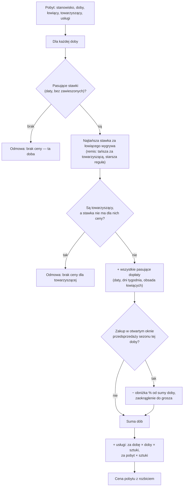

# Wycena pobytu

## W skrócie

Cena pobytu to **suma cen kolejnych dób** plus **usługi dodatkowe**. Każdą dobę wycenia się osobno:

1. **Stawka** — z cennika łowiska bierze się stawki, które obowiązują w tę dobę (zależą tylko od dat). Jeśli
   pasuje kilka, **wygrywa najtańsza** dla łowiącego — bez priorytetów. Stawka ma cenę za osobę łowiącą i za
   osobę towarzyszącą.
2. **Dopłaty** — wszystkie pasujące dopłaty **sumują się**. Dopłata może zależeć od dat, dni tygodnia i liczby
   łowiących (np. „wyłączność stanowiska"); dotyczy łowiących, wszystkich albo tylko towarzyszących.
3. **Obniżka przedsprzedażowa** — gdy wędkarz kupuje w otwartym oknie przedsprzedaży sezonu, od sumy tej doby
   (stawka + dopłaty) odejmuje się procent, zaokrąglony do grosza.

Potem dochodzą **usługi dodatkowe**: „za dobę" (cena × liczba dób × liczba sztuk, np. łódka) albo „za pobyt"
(cena × liczba sztuk, np. pellet).

**Doba bez stawki nie jest darmowa** — jest niesprzedawalna. Wtedy odmowa wskazuje, której doby brakuje,
i rozróżnia „brak stawki" od „stawka nie ma ceny dla osoby towarzyszącej". Obsługa może taki pobyt sprzedać
z **ceną uzgodnioną** (z powodem).

Wycenę widać zawsze z rozbiciem — w formularzu rezerwacji, w kalendarzu i w portalu — i to rozbicie zamraża się
w rezerwacji.

## Przebieg

## Dla zespołu

| Krok | Gdzie | Decyzja |
|---|---|---|
| Rozstrzygnięcie stawek i dopłat | `StayPricing`, `PriceRuleResolver` | ADR-014 |
| Przedsprzedaż | `SalePeriodFinder::hasOpenPresale()` | zadanie 018 |
| Usługi | `StayServicePricing`, `StayServiceLine::amountInCents()` | zadanie 020 |
| Złożenie oferty (sprzedawalność + cena) | `StayOffer` | ADR-015 |
| Rozbicie do pokazania | `StayPriceExplanation` | zadanie 047 |

Konwencje: [`cennik.md`](../conventions/cennik.md) §1–§7.
